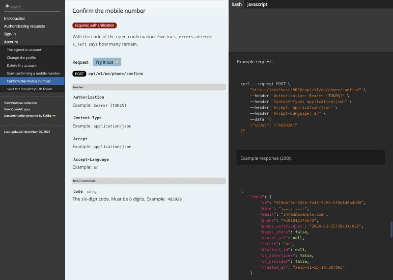

# Report 005: Sign-in

- PR: #8 (https://github.com/AbdulrahmanMasoud/awez-eh/pull/8). CI: see the PR.
- Branch: task/005-sign-in. Commit: ef2e9f6 (the last before this report).

## What changed

- **Residents can sign in** with Google or Apple. The app sends the ID token it got from the provider, and the API checks it against Google's or Apple's published keys. Each phone gets its own token; signing in again on the same phone replaces it.
    - The account is found by its Google or Apple link, else joined to an active account with the same verified email, else created.
    - A suspended account cannot sign in or use any signed-in route.
- **A resident confirms a mobile number** with a six-digit code.
    - Until WhatsApp confirmation comes (step 4.3b), the code is written to a developer log, which runs only locally and in tests: the app refuses to start with it anywhere else.
    - A code lasts ten minutes and allows five tries; the answer says how many are left.
    - A number confirmed on another account is refused.
    - Limits: three starts per number in ten minutes and ten a day, five per account an hour, twenty per address an hour. Over a limit, the answer says when to try again.
- **A resident sees and edits their own account** (name, language, district) and saves their phone's push token, ready for notifications in step 3.4. Signing out removes the phone's token and its push token.
- **Deleting an account** signs out every phone and wipes the personal data: name, email, number and picture. The row itself stays as "حساب محذوف", because chats, bookings, reviews and leads point at it. In detail:
    - brokered properties are archived and kept, with their agreements and leads;
    - other listings go, unless someone talked about, booked, saved or reported them, in which case they are archived;
    - the craftsman profile is archived;
    - places stay, without an owner;
    - requests go, or are closed when someone replied;
    - favorites, saved searches and open reports go.

  Signing in again with the same Google account starts a new, empty account.
- **The API has its first real endpoints and their documentation:** `sail composer docs` generates it, and it is served at http://localhost:8020/docs, locally only. It has Arabic examples, every error code and the `Accept-Language` header. The temporary `GET /api/v1/ping` is gone.
- **Arabic field names in errors:** "حقل الاسم مطلوب" instead of "حقل name مطلوب" for every field of these endpoints (task 002's follow-up).

## Decisions for the owner

1. **Your dev database needs rebuilding after the merge.** I edited task 001's `users` migration, as DECISIONS 21 allows, and `migrate` never re-runs a migration that already ran. The main checkout's dev database was created last session with the old `users` table, and it holds only reference data: no demo and no users. The choices are below.
    - **Rebuild it** with `sail artisan migrate:fresh --seed`. This deletes the reference data and seeds it again, with a demo city. You said never to `migrate:fresh` the dev database, so I have not done it, and I will not do it without your word.
    - **Keep it,** and every new column of `users` is missing: sign-in fails there.
2. **`spatie/laravel-data`:** CLAUDE.md names it for Data objects, but it is not installed. I used plain `final readonly` classes (DECISIONS 81) and added the question to OPEN_QUESTIONS 6. Installing it is one `composer require` and a light refactor; keeping plain classes means editing that line of CLAUDE.md.
3. **`platform` at sign-in is not taken.** The brief lists it in the body, but nothing would store it. The push token endpoint carries the platform instead (DECISIONS 74). Say if you want it on the access token, as a column of `personal_access_tokens` or in the token's name.
4. **Tokens never expire** (Sanctum's default, `expiration: null`). They end on sign-out and on deleting the account. A lifetime, such as a year, is one setting.
5. **Choices beyond the brief:**
    - an unverified email is never linked or stored;
    - a suspended account found by its email also refuses a sign-in with the other provider;
    - a used item something points at is archived, not deleted;
    - replies the account wrote to others' requests stay;
    - resolved reports stay (DECISIONS 72 and 73).
6. **The deleted account's database notifications stay** until the Notifications domain gets its Actions in step 3.4 (DECISIONS 72).
7. **Housekeeping:** none was due. Tasks 001–004 were already `done`, with no worktrees left. The main checkout's Sail stack is stopped, its volumes kept, so this worktree's stack could use port 8020.

## The owner's steps

1. **Google and Apple clients** (BUILD_PLAN phase 0), when you have them: set these env names in `.env` locally and in Dokploy later:
    - `AWEZ_GOOGLE_CLIENT_IDS`: the Android, iOS and web client ids, comma-separated;
    - `AWEZ_APPLE_CLIENT_IDS`: the app's bundle id.

   Until they are set, every real ID token is refused (OPEN_QUESTIONS 6).
2. **To try sign-in locally** before then, set `AWEZ_SIGN_IN_FAKE=true` in your `.env` and sign in with `fake:<any email>` as the ID token. Confirmation codes are in `storage/logs/phone-verification.log`.
3. **After merging,** in the main checkout:
    - `git pull`;
    - `sail composer install` (two new packages);
    - the dev database, as you decide in decision 1;
    - `sail composer docs` for `/docs`.
4. **Production** (step 4.4) must set `AWEZ_PHONE_VERIFICATION_DRIVER=whatsapp_inbound` (step 4.3b), because the app refuses to boot there with the `log` driver or the fake sign-in.

No DNS or Dokploy changes yet.

## Verification

**`sail composer check`:** Pint, Rector and Larastan (max level, no baseline) pass, and Pest passes 956 tests with 2,387 assertions in 38 s. Task 004 left 809. This task's new files hold 140 tests, ping's 5 are gone, and the tests that run once per model or per enum cover the three new models. The new files:

| File | Tests | What |
| --- | --- | --- |
| `Identity/IdentityTokenVerifierTest` | 32 | Google and Apple tokens with a key pair made in the test and the JWKS faked: valid tokens; each way one is wrong (signature, `kid`, issuer, audience, expired, issued in the future, `nbf`, no `exp`, no `sub`, not a JWT, no `kid`); the 60 s leeway; Apple's nonce missing, empty, wrong, absent or raw; no client ids configured; keys cached for `max-age`, an hour without it; one refresh for a rotated key, only one for an unknown `kid`; keys unreachable; the fake driver only when on |
| `Identity/SignInTest` | 17 | 201 then 200; the subject wins over a changed email; one token per device; linking by verified email, any case; unverified emails neither linked nor stored; Apple's name; a default name; one error for every bad token; suspended by link or by email; the fake driver on and off |
| `Identity/AccountTest` | 23 | `GET me` with the resource shape; `needs_phone`; advertiser and provider derived; route names; JSON whatever `Accept` says; 401; `account_suspended` on all 7 signed-in routes; `last_seen_at` at most every five minutes, `updated_at` untouched; `PATCH me` partial changes and refusals; rate limits per IP and per user |
| `Identity/PhoneVerificationTest` | 20 | the challenge shape; only an HMAC stored; the code in its own log only, the number masked; confirming; wrong codes with attempts left; used up after five; expired after ten minutes; nothing to confirm; a new start replaces the open one; `phone_taken` at start and at confirmation; one's own number again; non-Egyptian or landline numbers; Arabic field names; each rate limit with `Retry-After`; no code sent over a limit; the WhatsApp challenge shape |
| `Identity/DevicesTest` | 5 | saving and replacing a push token; one push token per device across accounts; an unknown platform; sign-out of one device takes its push token |
| `Identity/DeleteAccountTest` | 13 | the anonymized row; tokens, links and confirmations gone; brokered properties archived with agreements and leads; other properties deleted or archived; provider archived; places released; used items; requests; favorites, alerts and reports; conversations, messages, bookings and reviews kept under the deleted name; no personal data in any API answer; a fresh account on signing in again; all or nothing |
| `Identity/DevelopmentDriversTest` | 8 | refused with the fake sign-in or the `log` driver in production and staging; allowed in local and testing; console commands that use no driver still boot, and the drivers throw when resolved; defaults read from `config/awez.php` with the variables unset |
| `Ownership/AccountOwnershipTest` | 9 | no `api/v1` route takes an id; `me` always answers for the token's user; A cannot change B's profile, confirm with B's code, touch B's push token or delete B; the Identity policies deny everyone |
| `Unit/Identity` | 9 | `RateLimit` (sliding window, `Retry-After`, edges) and `PhoneCodeHasher` |
| `Arch/IdentityTest` | 4 | `Identity\Contracts` holds interfaces only; the drivers implement them; only `App\Domains\Identity` (and tests) use `Firebase\JWT` |

`LocaleTest` and `ErrorResponsesTest` now use `GET me` and the Arabic field names. The schema tests cover the new foreign keys' delete rules. A random collision in task 004's demo seeder surfaced, and is fixed (see the follow-ups); its test then passed six runs in a row.

**CI's first run failed** before the tests, at `composer install`. Its `package:discover` boots the app before CI writes a `.env`, so the environment is `production`, and the boot check refused the `log` driver; a production image build would fail the same way.

- Console commands now skip the boot check.
- The drivers refuse themselves wherever they are resolved, which a test proves.
- The app serving requests still refuses to boot with either driver.

A local `APP_ENV=production artisan package:discover` passes (DECISIONS 71).

**Coverage** of `app/Domains`: 98.2% (810 of 825 statements). Not covered: the race in which another account confirms the same number between the check and the save (the unique index answers `phone_taken`), and two lines of the decoder.

**Migrations on `testing`:**

```
$ DB_DATABASE=testing artisan migrate:fresh --seed     (4 s, demo seeders included)
  0001_01_01_000000_create_users_table .......................... 50.51ms DONE
  2026_11_25_200000_create_identity_tables ...................... 46.01ms DONE
$ artisan migrate:rollback --step=1
  2026_11_25_200000_create_identity_tables ...................... 40.85ms DONE
$ artisan migrate
  2026_11_25_200000_create_identity_tables ...................... 95.89ms DONE
$ artisan migrate:reset        (every down(), the edited users migration's included)
  0001_01_01_000000_create_users_table .......................... 12.67ms DONE
$ artisan migrate
  0001_01_01_000000_create_users_table .......................... 44.20ms DONE
  2026_11_25_200000_create_identity_tables ...................... 46.05ms DONE
```

`\d users` on `testing` (the "referenced by" list left out):

```
 email             | character varying(255) |  |          |
 password          | character varying(255) |  |          |
 phone             | character varying(255) |  |          |
 phone_verified_at | timestamp(0) without time zone |  |   |
 avatar_url        | text                   |  |          |
 locale            | character varying(255) |  | not null | 'ar'::character varying
 status            | character varying(255) |  | not null | 'active'::character varying
 suspended_at      | timestamp(0) without time zone |  |   |
 deleted_at        | timestamp(0) without time zone |  |   |
 last_seen_at      | timestamp(0) without time zone |  |   |
 district_id       | uuid                   |  |          |
Indexes:
    "users_district_id_index" btree (district_id)
    "users_email_unique" UNIQUE, btree (email) WHERE email IS NOT NULL
    "users_phone_unique" UNIQUE, btree (phone) WHERE phone IS NOT NULL
Check constraints:
    "users_deleted_check" CHECK ((status::text = 'deleted'::text) = (deleted_at IS NOT NULL))
    "users_locale_check" CHECK (locale::text = ANY (ARRAY['ar', 'en']))
    "users_phone_verified_check" CHECK ((phone IS NULL) = (phone_verified_at IS NULL))
    "users_status_check" CHECK (status::text = ANY (ARRAY['active', 'suspended', 'deleted']))
    "users_suspended_check" CHECK ((status::text = 'suspended'::text) = (suspended_at IS NOT NULL))
Foreign-key constraints:
    "users_district_id_foreign" FOREIGN KEY (district_id) REFERENCES districts(id) ON DELETE RESTRICT
```

`phone_verifications` has indexes on `(phone, created_at)`, `(user_id, created_at)` and `(ip_address, created_at)`. `device_tokens` has a unique `personal_access_token_id`, which cascades from `personal_access_tokens`, and a unique `token`. `social_accounts` is unique on `(provider, subject)` and on `(user_id, provider)`.

**Real run** on http://localhost:8020 with `AWEZ_SIGN_IN_FAKE=true`. It ran on this worktree's own dev database, an empty Docker volume of its own, migrated and seeded with reference data; your dev database was not touched. Responses are trimmed to the status line, `Retry-After` and the body:

```
$ POST /auth/google  {"id_token":"fake:ahmed@example.com","device_name":"Pixel 8"}   (a new account)
HTTP/1.1 201 Created
{"data":{"token":"1|rUSrTekWLsTyNvre539M7yDHGEFABqlD4AiLv4tJ79c4b018","user":{"id":"01a21300-c855-7662-856b-85ef5cfd79b7","name":"ahmed","email":"ahmed@example.com","phone":null,"phone_verified_at":null,"needs_phone":true,"avatar_url":null,"locale":"ar","district_id":null,"is_advertiser":false,"is_provider":false,"created_at":"2026-11-25T13:59:08Z"},"needs_phone":true}}
$ POST /auth/google  (the same identity again, same device)
HTTP/1.1 200 OK
{"data":{"token":"2|sDySLMkXVKg2P9BN9YAX9Tz9EhUFNJwhZkD8JFMb77582c47","user":{"id":"01a21300-c855-7662-856b-85ef5cfd79b7",...},"needs_phone":true}}
$ GET /me
HTTP/1.1 200 OK
{"data":{"id":"01a21300-c855-7662-856b-85ef5cfd79b7","name":"ahmed","email":"ahmed@example.com","phone":null,"phone_verified_at":null,"needs_phone":true,...}}
$ POST /me/phone  {"phone":"01012345678"}
HTTP/1.1 201 Created
{"data":{"method":"code","expires_at":"2026-11-25T14:09:08Z","length":6}}
$ tail -1 storage/logs/phone-verification.log
[2026-11-25 13:59:08] local.INFO: Phone verification code 160637 for 010*****678 {"code":"160637","phone":"010*****678","user_id":"01a21300-c855-7662-856b-85ef5cfd79b7","expires_at":"2026-11-25T14:09:08Z"} {"request_id":"b60e4027-98b0-4090-b856-68f1113ad521"}
$ POST /me/phone/confirm  {"code":"000000"}   (wrong)
HTTP/1.1 422 Unprocessable Content
{"message":"كود التأكيد غير صحيح.","code":"verification_code_invalid","errors":{"attempts_left":4}}
$ POST /me/phone/confirm  {"code":"160637"}   (the code from the log)
HTTP/1.1 200 OK
{"data":{"id":"01a21300-c855-7662-856b-85ef5cfd79b7","name":"ahmed","email":"ahmed@example.com","phone":"+201012345678","phone_verified_at":"2026-11-25T13:59:08Z","needs_phone":false,...}}
$ POST /auth/apple  {"id_token":"fake:mona@example.com","nonce":"n-1","name":"منى عادل","device_name":"iPhone"}   (a second account)
HTTP/1.1 201 Created
{"data":{"token":"3|2882Xe4Fo54H3N2sKCPOFSTI7H0iCwPGEIQfNwVwc3f12853","user":{"id":"01a21300-cb8e-7466-9b77-3b06b2da4566","name":"منى عادل","email":"mona@example.com",...},"needs_phone":true}}
$ POST /me/phone  {"phone":"+20 101 234 5678"}   (as Mona: Ahmed confirmed it)
HTTP/1.1 409 Conflict
{"message":"هذا الرقم مؤكَّد على حساب آخر.","code":"phone_taken","errors":{}}
$ POST /me/phone  {"phone":"01112345678"}   (Mona, starts 1, 2 and 3)
HTTP/1.1 201 Created   (three times)
$ POST /me/phone  {"phone":"01112345678"}   (Mona, start 4 within 10 minutes)
HTTP/1.1 429 Too Many Requests
Retry-After: 600
{"message":"محاولات كثيرة لتأكيد الرقم. حاول مرة أخرى بعد قليل.","code":"too_many_attempts","errors":{}}
$ PUT /me/device-token  {"token":"fcm-demo-token-pixel-8","platform":"android","app_version":"1.0.0"}
HTTP/1.1 201 Created
{"data":{"platform":"android","app_version":"1.0.0","last_used_at":"2026-11-25T13:59:09Z"}}
$ POST /auth/sign-out
HTTP/1.1 204 No Content
$ GET /me   (with the signed-out token)
HTTP/1.1 401 Unauthorized
{"message":"سجّل الدخول أولًا.","code":"unauthenticated","errors":{}}
$ POST /auth/google  {"id_token":"fake:ahmed@example.com","device_name":"Pixel 8"}   (sign in again)
HTTP/1.1 200 OK
$ DELETE /me
HTTP/1.1 204 No Content
$ GET /me   (with the deleted account's token)
HTTP/1.1 401 Unauthorized
```

The deleted account in psql:

```
                  id                  |    name    |      email       | phone | phone_verified_at | avatar_url | status  |     deleted_at
--------------------------------------+------------+------------------+-------+-------------------+------------+---------+---------------------
 01a21300-cb8e-7466-9b77-3b06b2da4566 | منى عادل   | mona@example.com |       |                   |            | active  |
 01a21300-c855-7662-856b-85ef5cfd79b7 | حساب محذوف |                  |       |                   |            | deleted | 2026-11-25 13:59:10

 tokens | social_accounts | phone_verifications | device_tokens
--------+-----------------+---------------------+---------------
      0 |               0 |                   0 |             0
```

The code (`160637`), the number in full (`01012345678`, `+201012345678`) and the tokens appear in neither `laravel.log` nor `laravel.json` (grep count 0); the code is only in `phone-verification.log`.

**API docs:** `sail composer docs` generated them for all 9 endpoints, and `GET /docs` answers 200. Below is "Confirm the mobile number", with the request, its headers (`Authorization`, `Accept-Language: ar`) and the Arabic example answer; each endpoint also lists its error codes with Arabic examples.



## Not done and follow-ups

- **The WhatsApp driver** (step 4.3b), as the brief says. `PhoneVerifier`, the `whatsapp` challenge and the `whatsapp_inbound` value are ready for it. Its confirmation comes from the webhook, not from `me/phone/confirm`.
- **Database notifications of a deleted account** (step 3.4, decision 6).
- **Published API docs** (step 4.4). The generated files are git-ignored and are made with `sail composer docs`.
- **Found on the way and fixed:** `DemoInteractionSeeder` (task 004) sometimes opened a second open conversation between a resident and a craftsman. The partial unique index refused it, failing `migrate:fresh --seed` at random. It now reuses the open conversation.
- **Found on the way, not changed:** on signed-in routes, Laravel runs `auth:sanctum` before the rate limiter, so a guest's 401s are not counted (DECISIONS 80). They cost no work.

## Deploy notes

- **Migrations:**
    - the edited `0001_01_01_000000_create_users_table`, for a fresh database only (decision 1; nothing is deployed);
    - the new `2026_11_25_200000_create_identity_tables` (`users.district_id`, `social_accounts`, `phone_verifications`, `device_tokens`).
- **New packages:**
    - `firebase/php-jwt` v7.2.2;
    - `knuckleswtf/scribe` 5.11.0 (dev), which also brings `mpociot/reflection-docblock` 1.0.1, `parsedown/parsedown` 1.8.0, `shalvah/upgrader` 0.6.0, `symfony/var-exporter` 8.1.10 and `symfony/polyfill-deepclone` 1.43.2.
- **New env names** (in `.env.example`): `AWEZ_GOOGLE_CLIENT_IDS`, `AWEZ_APPLE_CLIENT_IDS`, `AWEZ_SIGN_IN_FAKE` (false; local only), `AWEZ_PHONE_VERIFICATION_DRIVER` (`log`; local and testing only).
- **New log channel:** `phone_verification`, at `storage/logs/phone-verification.log`.
- **Outbound HTTPS** to `www.googleapis.com` and `appleid.apple.com` for their keys, cached for their `max-age`.
- **Removed:** `GET /api/v1/ping`.

## Update (2026-11-25)

The owner's answers:

1. **The dev database** is rebuilt with `sail artisan migrate:fresh --seed`, approved this once, after the merge.
2. **`spatie/laravel-data` 4.23.1 is installed** (with `spatie/laravel-package-tools` 1.93.3 and `spatie/php-structure-discoverer` 2.4.4).
    - `VerifiedIdentity`, `PhoneChallenge`, `ProfileChanges`, `SignedIn` and `IssuedPhoneCode` now extend `Data`.
    - They are `final` with `readonly` properties. `final readonly` classes are not possible: `Data` keeps a mutable context, and a readonly class can extend only a readonly one.
    - `ProfileChanges` uses `Optional` for the fields `PATCH me` leaves out, and `UpdateProfileRequest::toData()` builds it with `ProfileChanges::from()`.
    - `IdTokenClaims` moved to `Drivers` as a plain class, because it is the decoder's view of a token and crosses no boundary.
    - A new arch rule: every domain's `Data` classes are final and extend `Data`. A throwaway plain class in `Identity\Data` fails it.
    - OPEN_QUESTIONS 6 is closed, and the client ids question is now 6 (DECISIONS 81).
3. **The platform is stored on the push token only** (DECISIONS 74).
4. **Tokens never expire**, Sanctum's default, now recorded (DECISIONS 74).
5. **The choices beyond the brief are approved** (DECISIONS 72 and 73).

**Verification:** `sail composer check` passes: Pint, Rector, Larastan, and Pest with 957 tests and 2,389 assertions (the new arch rule adds one). The account and profile tests pass unchanged against the converted Data objects.

**Deploy notes, added:** `spatie/laravel-data` 4.23.1 and its two dependencies.
