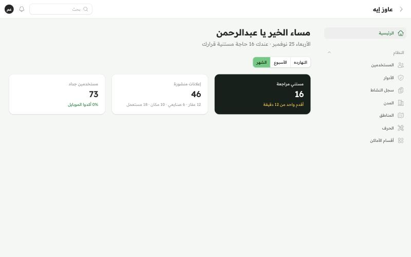
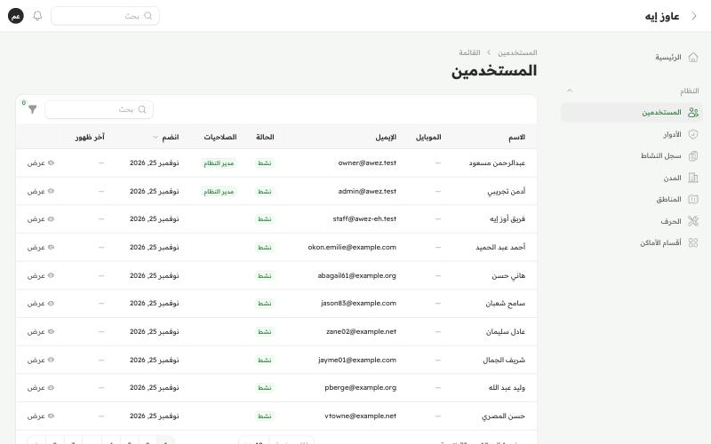
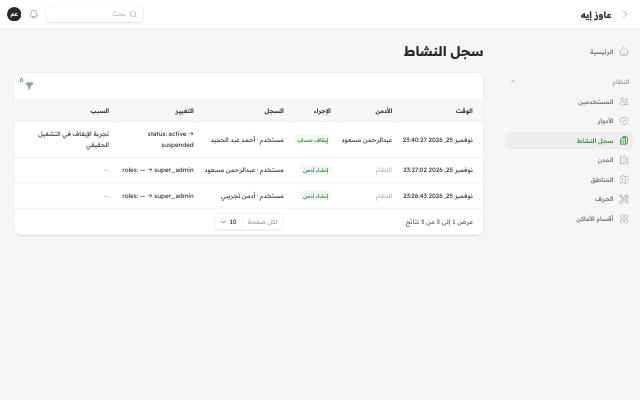

# Report 006: Admin panel foundation

- PR: #11 (https://github.com/AbdulrahmanMasoud/awez-eh/pull/11). CI: see the PR.
- Branch: task/006-admin-panel-foundation. Commit: cdfcfe6 (the last before this report).

## What changed

- **The admin panel is live at `/admin`.** It is in Arabic and right to left, in the brand's green with Readex Pro, as `docs/design/ADMIN_PANEL.md` describes. Each admin can switch it to English from the user menu, and the choice stays on their account.
- **Only admins get in, and only with two-factor authentication.**
    - An admin is an account with an admin role and a password. Residents get "forbidden", even when signed in to the app.
    - On first sign-in an admin must set up an authenticator app (Google Authenticator or similar) and save eight recovery codes before seeing any page.
    - Five wrong passwords a minute lock the sign-in for that address.
    - An admin suspended while signed in is signed out on their next click.
- **You create admins from the terminal:** `awez:create-admin` asks for a name, an email, a role and a password (twice, hidden, at least 12 characters). It never prints the password and is the only way to make the first super admin.
- **Four roles, each seeing its own menu:**
    - مدير النظام (super admin): everything;
    - مراجع المحتوى (moderator): users, suspend and reactivate, show a number;
    - إدخال بيانات (data entry): cities, districts, trades and place categories;
    - مبيعات (sales): users, to look up.

  A super admin can change what each role may do on the roles screen (الأدوار).
- **Admin rights work in the panel only.** If an admin also uses the app, the app treats them as a resident, so a role can never be used to change someone else's listing through the app.
- **Every admin action is recorded** in سجل النشاط: who, what, which record, why, before and after, in Cairo time, and never a name, email or number. Recorded actions:
    - changes to cities, districts, trades and place categories;
    - suspending and reactivating accounts, changing roles;
    - each time someone looks at a full phone number.
- **The screens:**
    - المدن, with each city's districts under it;
    - المناطق, in their order;
    - الحرف and أقسام الأماكن, reorderable, each with its Lucide icon shown.

  Nothing in reference data can be deleted, only deactivated.
- **المستخدمين:**
    - every account with its masked number, status, roles, join date and last visit;
    - filters (status, confirmed number, craftsman, advertiser, admin), and search by name, email, or a number typed any way;
    - each account's page shows its sign-in providers, devices and how much it has posted;
    - suspend (with a required reason; the account is signed out of every phone and browser), reactivate, change roles (super admin only, and never the last super admin), and show the number (super admin and moderator, recorded each time).

  Nobody can create, edit or delete a resident's account here: residents own their accounts.
- **The dashboard** greets the admin by first name, with today's Cairo date and how many items wait for a decision. It shows the three numbers that exist today, for today, the week or the month:
    - waiting for review, with the oldest item's age;
    - listings published, by kind;
    - new users, with the share who confirmed a phone.

  The other widgets arrive with their steps, never with made-up numbers.







## Decisions for the owner

1. **The font comes from a CDN.**
    - Readex Pro loads from Bunny Fonts (a privacy-respecting mirror of Google Fonts) on every page, through Filament's default font loading.
    - During the real run this machine lost internet for a while, and each page waited for the font until the request failed.
    - Self-hosting the font in the theme build (the files in `public/build`) removes that dependency, at the cost of a slightly larger build.
    - I recommend it, as a small follow-up; say if you agree.
2. **The review queue ignores the period filter** (DECISIONS 94). The brief has all three widgets follow it, but a queue filtered by date hides its oldest items, which are the ones that need you. The other two follow the period.
3. **The periods are rolling windows:** today from midnight in Cairo, then the last 7 and the last 30 days, so a period always compares with one of the same length. Calendar weeks starting on Saturday are the alternative.
4. **Reference data, users, roles and the activity log are all under النظام**, the only group with entries for now. The design's المحتوى and النشاط groups appear when their screens arrive.
5. **The digit style** (Arabic-Indic or Western) is still open (OPEN_QUESTIONS 7); the panel uses Filament's locale formatting meanwhile.
6. **Housekeeping:** none was due. Tasks 001–005 are `done`, with no worktrees left. The main checkout's Sail stack is stopped, its volumes kept, so this worktree's stack could use port 8020.

## The owner's steps

1. **After merging,** in the main checkout:
    - `git pull`;
    - `sail composer install`;
    - `sail npm ci` and then `sail npm run build` (the panel's theme);
    - `sail artisan migrate` (five migrations);
    - `sail artisan db:seed --class=ReferenceDataSeeder` (it adds the roles and permissions).
2. **Create your own admin account** on your machine, in a terminal (the password is typed, never passed):

   ```bash
   sail artisan awez:create-admin --name="عبدالرحمن" --email=you@example.com --role=super_admin
   ```

   Then sign in at http://localhost:8020/admin and scan the QR code with your authenticator app. Keep the eight recovery codes somewhere safe; they are shown once.
3. **The demo admin**, in local and testing only after `migrate:fresh --seed`: `admin@awez.test` with the password `awez-admin-demo`. It also sets up two-factor on first sign-in.
4. **Look at, in Arabic:**
    - the dashboard;
    - المستخدمين: open one account, suspend it with a reason, then see it in سجل النشاط and reactivate it;
    - الحرف: open one to see the icon list;
    - المدن: open Sadat City, with its districts under it;
    - الأدوار: the roles screen, from Shield.

No DNS or Dokploy changes yet.

## Verification

**`sail composer check`:** Pint, Rector and Larastan pass, and Pest passes 1,057 tests with 2,800 assertions in 55 s. `main` had 958; this task adds 99:

| File | Tests | What |
| --- | --- | --- |
| `Admin/PanelAccessTest` | 14 | a guest is sent to sign in; residents, admins without a password and passwords without a role get 403; an admin without two-factor is sent to set it up; an admin with it enters in Arabic and RTL; English for an admin who chose it, sidebar included; a suspended admin is signed out on the next request; each role's exact sidebar; empty groups hidden; the persistent middleware list |
| `Admin/ReferenceDataResourcesTest` | 33 | each of the four screens per role (list, create and edit: 200 for super admin and data entry, 403 for moderator and sales); no delete anywhere; a city from its coordinates, shown again on edit and deactivated; impossible coordinates refused; districts under their city; a district's slug unique within its city only; trades reordered by dragging, or refused; icons only from the Lucide list; a subcategory under a top-level category |
| `Admin/UsersResourceTest` | 20 | who sees users; no create, edit or delete; numbers masked in the list and the page; each filter; search by a spaced number and by email, in the table and the global search; the account page; suspend (reason required, tokens and sessions gone, logged with reason and before and after); reactivate; which role sees which action; no self-suspension; show the number (logged without the number); roles (logged); the last super admin keeps the role |
| `Admin/ActivityLogTest` | 8 | the page for super admins only; a panel edit logged with its admin and before and after; seeders and code outside the panel not logged; newest first, filtered by admin, action and date; no personal data in the log |
| `Admin/DashboardTest` | 6 | the three periods' starts; new users and the confirmed share per period; listings published per period by kind; the whole queue with its oldest item; the widget's figures per period; the greeting and the waiting count |
| `Admin/CreateAdminCommandTest` | 7 | creates a super admin and prints no password; promotes an account, keeping its name; refuses a short password, a mismatch, an unknown role, a suspended account, and running without a terminal |
| `Admin/AdminPermissionsTest` | 6 | our permission names equal Shield's catalogue; the roles seeded with their permissions, twice; seeding keeps what a super admin added; permissions count inside the panel only; residents hold none; the demo admin in local and testing only |
| `Identity/DeleteAccountTest` | +2 | deleting an admin account removes its roles and authenticator; the last super admin's account cannot be deleted (409) |
| `Arch/AdminPanelTest` | 3 | Filament resources, pages and widgets only in `App\Filament`; its classes final; domains never use Filament's facade |

The schema tests cover the new foreign keys, and the existing morph map and seeder tests take the new short names and the demo admin.

**Coverage:** `app/Domains` 98.3% (952 of 968 statements), `app/Filament` 97.3%.

**The theme** builds with `sail npm run build` (Vite 8, Tailwind 4.3), and CI now builds it as its own step.

**Migrations on `testing`:**

```
$ DB_DATABASE=testing artisan migrate:fresh --seed     (5 s, demo seeders included)
  2026_11_26_100000_create_permission_tables .................... 35.76ms DONE
  2026_11_26_100100_create_activity_log_table ................... 11.25ms DONE
  2026_11_26_100200_add_two_factor_columns_to_users_table ........ 2.01ms DONE
  2026_11_26_100300_add_status_index_to_users_table .............. 2.02ms DONE
  2026_11_26_100400_change_notifications_data_to_jsonb .......... 14.41ms DONE
  Database\Seeders\DemoAdminSeeder ............................... 263 ms DONE
$ artisan migrate:rollback --step=5     (all five down, newest first)
$ artisan migrate                       (all five up again)
```

**Real run** on http://localhost:8020, on this worktree's own dev database (its own Docker volume; your dev database was not touched):

1. **`awez:create-admin`**, in a terminal:

   ```
    Password (at least 12 characters)
    •••••••••••••••••••••••
    Password again
    •••••••••••••••••••••••
    INFO Created owner@awez.test as super_admin. They set up two-factor authentication when they first sign in at http://localhost:8020/admin.
   ```

   The password appears nowhere in the transcript (0 matches). Run without a terminal, the command now says it must be typed.
2. **Two-factor setup.** I signed in at `/admin/login` and was sent to إعداد المصادقة الثنائية. I opened the setup, took the key shown under the QR code, entered the six-digit code an authenticator app would show and the current password, and was given eight recovery codes. The authenticator was enabled ("تم تفعيل تطبيق المصادقة") and I continued to the dashboard (the screenshot above).
3. **Every page answered 200 for this super admin:** `/admin`, `/admin/users`, `/admin/shield/roles`, `/admin/activity-log`, and the list and create pages of cities, districts, trades and place categories.
4. **A resident's session got 403** on `/admin`, `/admin/users`, `/admin/cities`, `/admin/activity-log` and `/admin/shield/roles`. A guest was sent to `/admin/login`.
5. **Suspending a demo account** from its page, with a reason, put this entry in سجل النشاط: "عبدالرحمن مسعود · إيقاف حساب · مستخدم · أحمد عبد الحميد · status: active → suspended · تجربة الإيقاف في التشغيل الحقيقي".
6. **The language switch** in the user menu turned the whole panel to English, left to right.

**What the real run caught, now fixed with tests:**

- **Every Livewire request signed the admin out.** I had marked the panel's whole middleware list as persistent. Livewire then ran the session and cookie middleware a second time inside its own requests: the notification bell's first request replaced the session, and the next click landed on the sign-in page.

  Found with a temporary request log, since removed. Only `SetAdminLocale` and `AuthenticateAdmin` are persistent now, and a test pins the list (DECISIONS 95).
- **The sidebar group stayed Arabic in English.** Filament reads an enum's labels once, at boot; the groups now read them when the sidebar is drawn, and the English test checks it.
- **Filament's notification bell failed on the database**, because Laravel's `notifications.data` column is text. It is `jsonb` now (DECISIONS 92).

## Not done and follow-ups

- **A map picker** for city and district centres (MapLibre, ADR 0005). Coordinates are typed for now, as the brief says.
- **Self-hosting Readex Pro** (decision 1).
- **The language switch has no automated test.** Filament draws the user menu in its layout, outside a page Livewire can test. It was checked in the real run, and the locale itself is tested.
- **The account page's counts** add up what exists today (listings, places, requests, replies, bookings, reviews). New kinds join with their steps.

## Deploy notes

- **New packages:**
    - `filament/filament` 5.12.0 (with `livewire/livewire` 4.4.10);
    - `bezhansalleh/filament-shield` 4.3.1;
    - `spatie/laravel-permission` 8.5.0;
    - `spatie/laravel-activitylog` 5.1.5;
    - `mallardduck/blade-lucide-icons` 2.0.51 (your approval).

  Their own dependencies come in too: `spatie/invade`, `spatie/shiki-php`, `pragmarx/google2fa` (two-factor) and Filament's packages.
- **Migrations:**
    - `create_permission_tables`;
    - `create_activity_log_table`;
    - `add_two_factor_columns_to_users_table`;
    - `add_status_index_to_users_table`;
    - `change_notifications_data_to_jsonb`.
- **Seeding:** `ReferenceDataSeeder` now creates the roles and permissions. It is idempotent, so run it on every deploy that adds a permission.
- **The build:**
    - `npm ci && npm run build` builds the panel's theme into `public/build`;
    - `composer install` runs `filament:upgrade`, which publishes Filament's assets to `public/js/filament`, `public/css/filament` and `public/fonts/filament`;
    - all of these folders are git-ignored and built on deploy.
- **The first admin in production:** `php artisan awez:create-admin` in a terminal on the server (step 4.4).
- **Outbound HTTPS** from admins' browsers to `fonts.bunny.net`, until decision 1.
